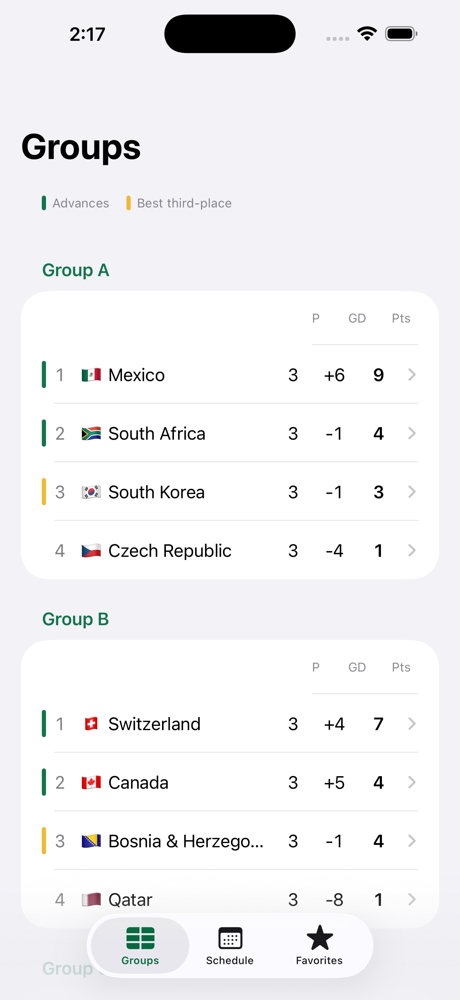
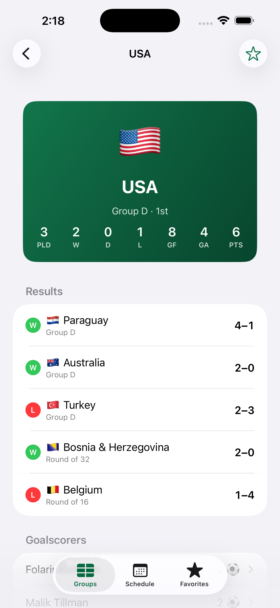

# World Cup 2026

A native iOS app for following the 2026 FIFA World Cup: group standings, the full match schedule, team pages, player goal logs, and favorite teams that persist between launches.

Built with SwiftUI, the Observation framework, async/await networking and SwiftData. It started as a 2022 workshop project and was rebuilt from scratch with a proper architecture and a test suite.

<p align="center">
  
  
</p>

## Features

- **Groups**: all 12 group tables, calculated on-device from match results, with advancement markers
- **Schedule**: every match grouped by day in your local time zone, including extra time and penalty shootouts
- **Team detail**: record, results with W/D/L badges, and goalscorers
- **Player detail**: every goal with minute, opponent and stage, plus a link to the player's highlights on YouTube
- **Favorites**: star a team to keep it on its own tab (stored with SwiftData)
- **Resilience**: loading, error and retry states, and a disk cache so the app still opens offline

## Data

Match data comes from the public [openfootball/worldcup.json](https://github.com/openfootball/worldcup.json) dataset (CC0), fetched over HTTPS. No account, API key or credentials are used, so there are no secrets in this repository.

The feed contains results but no standings, so the app computes them itself (points, goal difference, goals scored, then name). Head-to-head tiebreakers are not implemented; for this tournament's data the order matches the official tables in all 12 groups.

## Architecture

```
World Cup App/
├── Models/        Plain value types and pure logic. No UI, no I/O.
│                  Match decoding, StandingsCalculator, TeamSummary, PlayerSummary
├── Services/      Networking and caching behind protocols (DataLoading, DataCache, MatchesProviding)
├── ViewModels/    TournamentViewModel (@Observable) and a generic LoadState<Value>
└── Views/         SwiftUI screens and small shared components
```

Design decisions worth knowing about:

- **Protocol-based services.** The view model depends on `MatchesProviding`, and the service on `DataLoading` and `DataCache`. Tests swap in stubs, so none of them touch the network.
- **Decoding is isolated.** The feed's awkward shape (kickoff split across two strings, `[home, away]` score arrays, stage inferred from two fields) is converted in one place. Unknown data fails loudly with a `DecodingError` instead of being guessed at.
- **One source of truth.** A single shared view model feeds every tab, so the tournament is downloaded once.
- **Cancellation is handled.** A load interrupted by the view going away doesn't surface as an error or overwrite good data with stale cache.
- **Own goals are credited correctly.** The feed lists them under the beneficiary team; the app excludes them from the unlucky player's tally.
- **Accessibility.** Rows have meaningful VoiceOver labels instead of reading every column.

## Testing

45 unit tests (XCTest) cover decoding edge cases, standings and tiebreakers, schedule grouping, penalty and extra-time results, own goals, the service and cache fallback, view-model load states, and SwiftData favorites using an in-memory store.

Run them in Xcode with **Cmd+U**.

## Requirements

- Built and tested with Xcode 26
- iOS 17.0+ (needed for `@Observable` and SwiftData)

Open `World Cup App.xcodeproj`, pick an iPhone simulator, and press **Cmd+R**.

## Possible next steps

- Match detail with a goal timeline
- Knockout bracket view
- Head-to-head tiebreakers
- A widget for a favorite team

## Credits

Match data: [openfootball](https://github.com/openfootball/worldcup.json), released under CC0.
